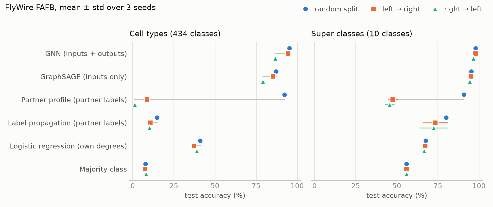
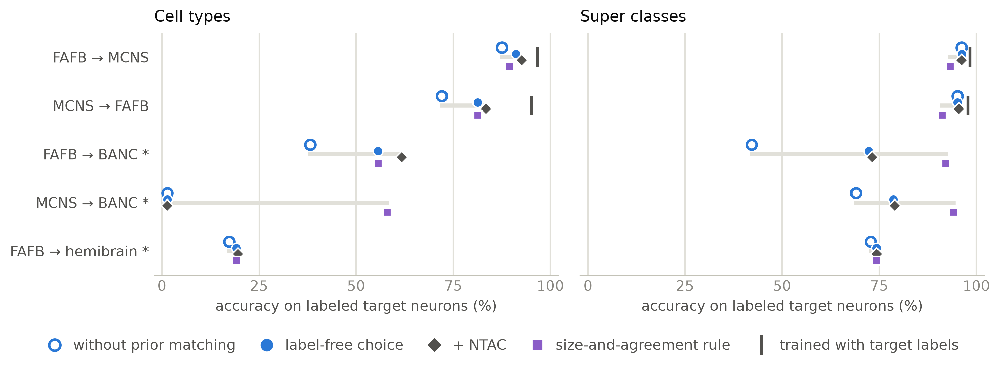
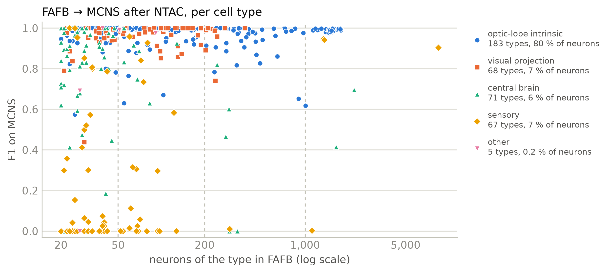
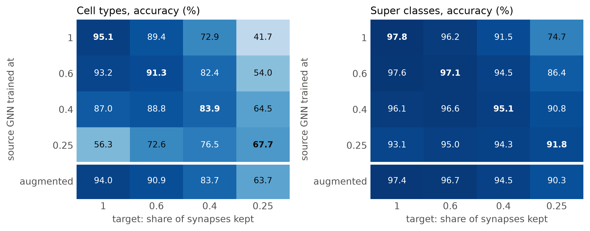
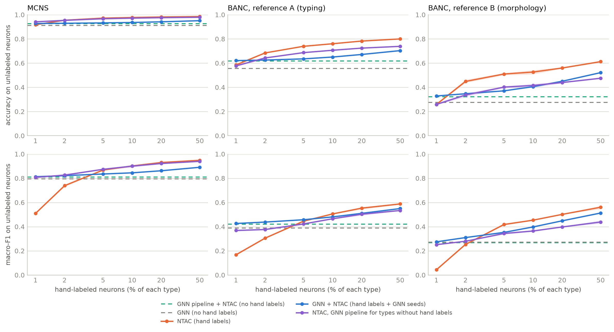

# Typing the neurons of an unlabeled connectome from wiring alone: label-free transfer across fly connectomes, and its limits

*Draft v0.1, October 2026. Maximilian Vogt. Numbers are from the repository's result files (README, `results/`); figures from `paper/make_figures.py`, `stratify.py` and `label_effort.py`. Items in [brackets] are open.*

## Abstract

Whole-brain connectomes are now reconstructed faster than they can be annotated, and cell types are increasingly assigned by matching connectivity to an annotated reference. Existing connectivity-based typing methods read the labels of a neuron's partners, so they need a partly labeled target. We ask how far a model that sees only anonymous wiring, never a partner's label, can go. A directed graph neural network with synapse-weighted aggregation over inputs and outputs (Dir-SAGE) identifies 434 cell types of the FlyWire brain with 95 % accuracy, and keeps 87–95 % on a hemisphere without any labels, where partner-label methods including NTAC fall below 10 %; the result replicates in the male CNS connectome. Between connectomes we transfer a trained model without any target label, choosing the preprocessing by label-free criteria and correcting its predicted type sizes to those of the reference (prior matching). On the pair the pipeline was developed on, FlyWire to the male CNS, 92.6 % of neurons get the right type out of 394 (macro-F1 0.76, against 96.6 % and 0.95 for a model trained with male labels); this is mainly an optic-lobe result (97 % there, 74 % for all other neurons). Rare types transfer as well: lowering the minimum type size from 20 to 10 FlyWire neurons covers 649 types at 93.0 %, and to 5 neurons 1,694 types at 90.3 %, with types of only 5–9 neurons typed correctly in 72 % of cases. We then tested the pipeline on two further connectomes under protocols committed before any model was run. On the sparser BANC brain, prior matching carried over (+13 to +18 points) but the label-free selection failed, once choosing a labeling that collapsed to one type; the pipeline reached 61.7 % against BANC's connectivity-aligned types, and 32 % in the central brain against types matched by morphology. A sandbox of degraded copies of the development connectomes, with known labels, reproduced the failure and led to a revised rule that stays within 4 points of the best candidate there; re-scored on BANC after the fact, it lands within 0.5 points in all four pre-registered runs. On the hemibrain, a partial volume and the first test of the revised rule, transfer failed (19.6 % on cell types), as the sandbox had predicted: partners outside the volume and cut neurons remove the context the model relies on. Controlled thinning shows that reconstruction density explains about half of the drop on BANC, that denser targets are harmless with prior matching, and that training with random thinning yields one model that works across densities. Measured against what an annotation team can do instead, the GNN's advantage is narrow: NTAC with about 1.3 % of each type labeled by hand matches it, so it is most useful with no labels at all or for the small types a small labeling budget misses. Agreement between independently trained models does not estimate a run's accuracy reliably, but where transfer works it flags errors: reviewing the 20 % least-agreed neurons finds 77 % of the errors on the male CNS.

## 1 Introduction

Electron-microscopy connectomes of the adult *Drosophila* brain now exist for several individuals: the female FAFB/FlyWire brain (Dorkenwald et al., 2024; Schlegel et al., 2024), the hemibrain (Scheffer et al., 2020), the male CNS (MCNS; Berg et al., 2026) and the female brain and nerve cord BANC (Bates et al., 2026). Their value rests on cell-type annotations, and new reconstructions are typed by matching their neurons to an annotated reference, by morphology and by connectivity (Schlegel et al., 2024; Bates et al., 2026). Connectivity-based typing compares each neuron's synaptic partners by type, as in the definition of optic-lobe types (Matsliah et al., 2024) and in NTAC (Schwartzman et al., 2026), and therefore needs labeled partners in the target.

We study the complementary setting: a model that sees only the anonymous wiring diagram, the directed graph of neurons and synapse counts, and is applied to neurons whose partners are unlabeled. This setting arises on an unlabeled hemisphere and, more importantly, on a newly reconstructed connectome. Our contributions:

1. **Anonymous wiring identifies cell types where partner labels are missing.** A Dir-SAGE GNN (Rossi et al., 2023) with synapse-weighted means reaches 95.3 % on 434 FlyWire cell types, close to NTAC (97.0 %), and keeps 87–95 % on an unlabeled hemisphere, where NTAC and a partner-profile classifier fall to 1–9 % (Section 4.1). Seeding NTAC with the GNN's confident predictions combines both (91–97 %).
2. **Label-free transfer between connectomes.** Prior matching of predicted type sizes to the reference and a label-free choice of preprocessing transfer the FlyWire model to the male CNS at 92.6 % (and 83.4 % in the reverse direction), without a single target label (Section 4.2). The pipeline was developed on this pair, so these are development numbers, and they are carried by the optic lobe.
3. **Two pre-registered tests and a development sandbox.** Applying the unchanged pipeline to BANC and the hemibrain under protocols fixed in advance showed which parts generalize: prior matching does, the original selection criterion does not, and partial volumes are beyond the approach. A sandbox of degraded development connectomes with known labels reproduced the failures and yielded a revised selection rule, which held on the pre-registered BANC runs and missed by 6.4 points on the hemibrain (Sections 4.3–4.5).
4. **How reconstruction density limits transfer.** Transfer between thinned copies of FlyWire separates density from other differences between connectomes (Section 4.4).
5. **Rare types.** Lowering the minimum type size to 10 and 5 FlyWire neurons keeps label-free transfer at 93.0 % (649 types) and 90.3 % (1,694 types); types with 5–9 neurons reach 72 % without a target label (Section 4.6).
6. **What the model is worth to an annotation team.** Against seeded NTAC with hand labels, the GNN is worth about 1.3 % hand labels by accuracy and 2–4 times that for small types at very low budgets; seed agreement flags most errors where transfer works, but run-level accuracy cannot be estimated without labels (Section 4.7).

We report the failures with the same care as the successes. In our experience the pre-registered tests were the most informative experiments of the project: each revealed an assumption the development data had hidden.

## 2 Related work

**Cell typing from connectomes.** Fly connectomes have been annotated with thousands of types from morphology and connectivity (Scheffer et al., 2020; Schlegel et al., 2024; Matsliah et al., 2024). In the optic lobe, types were defined from each neuron's input and output vectors over types (Matsliah et al., 2024). NTAC (Schwartzman et al., 2026) automates this from labeled seeds and exceeds 90 % on the FlyWire brain. Learned approaches mostly use morphology (Troidl et al., 2024) or combine it with connectivity (NeuNet; Liao et al., 2024), where connectivity alone reached 59 % on hemibrain classes. Across datasets, types are matched by NBLAST, connectivity alignment and combinations of both (Schlegel et al., 2024; Bates et al., 2026). Label-free structure has been used too: adjacency spectral embedding with Gaussian mixtures recovers biologically meaningful neuron groups in the larval mushroom body (Priebe et al., 2017), and graph matching pairs bilaterally homologous neurons across hemispheres from connectivity alone (Pedigo et al., 2023). These approaches cluster within one graph or match neuron to neuron; the typing methods read partner labels or are evaluated within one labeled graph. We know of no evaluation of a trained typing model transferred to an unlabeled connectome.

**Directed and heterophilic graph learning.** Neurons mostly connect to neurons of other types, a heterophilic setting in which standard message passing struggles (Zhu et al., 2020). Aggregating separately over in- and out-neighbors (Dir-GNN; Rossi et al., 2023) raises effective homophily; our model is Dir-SAGE (Hamilton et al., 2017; Rossi et al., 2023) with synapse-weighted means.

**Domain adaptation without target labels.** Prior matching is a form of label-shift correction (Saerens et al., 2002) and of optimal transport with fixed class marginals (Sinkhorn scaling), and it mirrors reference mapping in single-cell genomics, where batch effects separate a query from an annotated atlas. Our revised selection rule uses agreement between independently trained models, which tracks their error under distribution shift (Jiang et al., 2022).

## 3 Data and methods

**Connectomes** (Table 1). FlyWire FAFB v783 is the development and source connectome. MCNS v1.0 (brain only) is the second development connectome; its `flywireType` annotation maps 394 of our 434 types. BANC v888 and the hemibrain v1.2.1 were used only in the pre-registered tests. Neurons are nodes, directed edges are connections weighted by synapse count. FAFB connections have at least 5 synapses (Codex); the other connectomes are aligned to this by fixed, label-free rules (Section 3.3).

*Table 1. Connectomes.*

| | FAFB v783 | MCNS v1.0 (brain) | BANC v888 (brain) | Hemibrain v1.2.1 |
|---|---|---|---|---|
| Role | source, development | development (both directions) | pre-registered test | pre-registered test |
| Neurons in the graph | 139,255 | 144,725 | 133,549 | 25,348 |
| Connections / synapses per neuron (≥ 5 synapses) | 26.8 / 364 | 35.9 / 494 | 8.6 / 100 | 26.7 / 387 |
| Neurons labeled with one of the 434 types | 108,647 | 109,901 (394 types) | 63,332 (409 types) | 7,639 (202 types) |
| Particularities | | male; synapse detection differs | sparse; types assigned by connectivity alignment to FAFB; no R1-6 photoreceptors | central brain only (no optic lobes); 16 % of neurons cropped |

**Labels.** Super classes (10) and cell types with at least 20 neurons in FAFB (434 types, 78 % of neurons); Section 4.6 lowers the minimum to 10 (779 types, 81 %) and 5 neurons (2,164 types, 87 %). We recommend the ≥ 10 set as the default for new results; Sections 4.1–4.5 and 4.7 use ≥ 20, the set the pre-registered protocols and saved models fix. In every target the labels are coded in FAFB's label space and used only for evaluation.

### 3.1 Model

Each neuron has six features: in- and out-degree, input and output synapses, and mean synapses per input and output connection (log-scaled, z-scored). A layer computes h'ᵢ = W_self hᵢ + W_in mean_in(h) + W_out mean_out(h), with means over pre- and postsynaptic partners weighted by synapse count. Cell types use 3 layers (300 epochs, class-weighted loss), super classes 4 layers (1,000 epochs); depth and options were chosen by validation macro-F1. The model never sees a partner's label, so it applies unchanged to an unlabeled graph.

Baselines, ordered by the information they use: majority class; logistic regression on a neuron's own features; label propagation; a partner profile (logistic regression on the share of synapses per partner type, using training labels); NTAC (Schwartzman et al., 2026; a memory-lean reimplementation checked step by step against the published package); GraphSAGE (inputs only, unweighted). Splits: random (70/15/15, stratified) and hemisphere (train and validate on one hemisphere, test on the other). Three seeds throughout.

### 3.2 Label-free transfer

A model trained on the source is applied to the target. Every choice is made without target labels:

- **Candidates.** Each target is built in a few alignment variants (Section 3.3); target features are normalized either with the source's training statistics or with the target's own; prior matching is applied with strength ρ ∈ {0, 0.25, 0.5, 0.75, 1}.
- **Prior matching.** Cell-type sizes are stereotyped across flies, but a transferred classifier shifts neurons between neighboring types. We rescale its class probabilities with weights v (Sinkhorn iterations) so that the expected number of neurons per type matches the type distribution the same model predicts on its source, scaled to the target; ρ interpolates between the raw prediction and full matching (pₖ · vₖ^ρ, renormalized).
- **Selection.** Originally, the candidate whose labeling (mean over three seeds) is most self-consistent on the target: each neuron of a random half gets the label of its most similar neuron in the other half (synapses per partner type, weighted Jaccard), and agreement is chance-corrected (Cohen's κ). The revised rule (Section 4.4) takes the best mean rank of two other label-free properties: the Jensen-Shannon divergence of the predicted type sizes from the prior, and the agreement between the three seeds' labelings.
- **Refinement.** NTAC on the target, seeded with the neurons on which all three seeds agree.

### 3.3 Alignment variants

Connectomes differ in synapse detection and completeness. Each target gets variants that align one statistic with FAFB by a fixed rule: `raw` (threshold 5, nothing aligned), `density` (the threshold whose connections per neuron are closest to FAFB's) and `scaled` (threshold 5, counts scaled so that synapses per neuron match FAFB's). For MCNS we use Janelia's published scaling factor (0.581) instead of the last rule.

### 3.4 Pre-registration and development sandbox

For BANC and the hemibrain, data, labels, candidates, the selection rule, the reported numbers and explicit expectations were committed to the repository before any model was run on the dataset (`docs/banc_protocol.md`, `docs/hemibrain_protocol.md`). Between the two tests we built a sandbox from the development connectomes with known labels: synapse counts binomially thinned before the threshold; cell types removed; the volume restricted to the central brain; a fraction of neurons cropped (each synapse of a cropped neuron kept with probability 0.1). For partial volumes, a coverage prior uses the type distribution predicted for the FAFB neurons inside the covered volume, those with at least 10 % of their synapses outside the optic-lobe neuropils; it needs only the list of covered neuropils.

## 4 Results

### 4.1 Within a connectome: anonymous wiring suffices, and is the only thing that works on an unlabeled hemisphere

*Figure 1. Test accuracy on FlyWire per method and split (mean over 3 seeds, whiskers: std).*

*Table 2. FlyWire, test accuracy % / macro-F1 (mean ± std, 3 seeds).*

| Method | Cell types, random | left → right | right → left | Super classes, random | left → right | right → left |
|---|---|---|---|---|---|---|
| Majority class | 7.8 / 0.00 | 7.5 / 0.00 | 8.1 / 0.00 | 55.9 / 0.07 | 55.9 / 0.07 | 56.1 / 0.07 |
| Logistic regression (own degrees) | 40.9 / 0.12 | 37.3 / 0.09 | 39.0 / 0.11 | 67.6 / 0.31 | 67.2 / 0.32 | 66.7 / 0.32 |
| Label propagation | 14.7 / 0.28 | 10.7 / 0.19 | 10.3 / 0.20 | 80.1 / 0.30 | 73.4 / 0.22 | 72.6 / 0.21 |
| Partner profile (partner labels) | 92.2 / 0.79 | 8.7 / 0.10 | 1.2 / 0.10 | 90.9 / 0.60 | 47.6 / 0.28 | 45.7 / 0.23 |
| NTAC (partner labels, iterative) | **97.0 / 0.93** | 8.4 / 0.20 | 8.8 / 0.19 | 94.4 / 0.78 | 78.4 / 0.49 | 82.4 / 0.58 |
| GraphSAGE | 87.1 / 0.77 | 85.2 / 0.72 | 79.2 / 0.69 | 95.3 / 0.62 | 95.1 / 0.63 | 94.4 / 0.63 |
| GNN (Dir-SAGE, weighted) | 95.3 / **0.93** | **94.5 / 0.90** | **86.7 / 0.87** | **97.9 / 0.85** | **97.9 / 0.84** | **96.6 / 0.76** |

With labeled partners, NTAC is the best cell-type method; the GNN comes close (95.3 vs. 97.0 %, equal macro-F1) without seeing any partner label and is best on super classes. On an unlabeled hemisphere, the median test neuron has no synapse to a labeled partner (optic-lobe circuits stay on their side), and partner-label methods collapse on cell types (1–9 %; NTAC stays below 9.4 % at any of 40 steps), while the GNN keeps 87–95 %. Aggregating over outputs as well as inputs adds 2–9 points over GraphSAGE of the same depth. Cell types are strongly heterophilic: only 3 % of synapses connect neurons of the same type. The right → left gap of 8 points concentrates on photoreceptors and lamina neurons, whose outgoing synapses are underdetected in FlyWire (Matsliah et al., 2024) and whose connection counts differ between the hemispheres.

The result replicates within MCNS: the GNN reaches 96.6 % (random), 95.4 % and 93.7 % (hemispheres) on cell types, NTAC 7.8–9.5 % on the hemispheres. Seeding NTAC with the predictions on which three GNNs agree yields 96.5 / 90.8 % (FlyWire) and 97.1 / 96.2 % (MCNS) on the unlabeled hemisphere.

### 4.2 Between complete connectomes: label-free transfer

*Figure 2. Label-free transfer per scenario (accuracy on labeled target neurons). Open circles: chosen preprocessing without prior matching; filled circles: the label-free choice with prior matching; diamonds: after NTAC; triangles: the revised selection rule; bars: a GNN trained with labels on the target. \* pre-registered tests; their filled circles and diamonds use the rule fixed in the protocol (consistency for BANC, the revised rule for the hemibrain).*

A single FlyWire GNN applied to MCNS with a label-free normalization reaches 73–75 % on cell types; the best alignment, found only post hoc, 85.7 %. The label-free pipeline chooses the alignment and normalization by type consistency, which ranks the 30 candidates like their accuracy (Spearman 0.95–0.97), and prior matching corrects the type sizes: 87.6 % without and 91.2 % with prior matching, and **92.6 % after NTAC, over 394 cell types without a single MCNS label**, against 96.6 % for a GNN trained on MCNS. Prior matching repairs the types the transfer over- or under-fills (T5a: 2,252 → 1,714 predicted neurons for 1,664 true ones; LC21: 13 → 115 for 153). Run unchanged in the reverse direction, the pipeline reaches 83.4 % on FlyWire (72.0 % without prior matching; 95.2 % trained within FlyWire). The larger gap is specific to FlyWire as a target: 2.2 % of its neurons belong to types absent from MCNS's mapping, photoreceptors cause 21 % of the errors (51 % correct in the left hemisphere, 83 % in the right), and Kenyon cell subtypes 15 %.

**Where the accuracy comes from.** The headline number is mostly the optic lobe (Figure 3; per region and type size for every run: README, `stratify.py`). 80 % of MCNS's labeled neurons belong to optic-lobe intrinsic types; they are typed at 97.2 % after NTAC and contribute 78.0 of the 92.6 points. The other 20 % are typed at 74.0 % (macro-F1 0.68). Visual projection neurons transfer almost as well as the optic lobe (95.7 %), central-brain types much worse (65.1 %; neuron-weighted F1 0.61), and the 71 central-brain types with at least 20 FlyWire neurons are a small part of the central brain dominated by Kenyon cells, whose subtypes account for 65 % of these neurons and 84 % of their errors (the other central-brain types: 84.5 %). Among sensory neurons, photoreceptors are typed at 96 %, olfactory receptor neurons at 18 %. Accuracy also falls with type size, from 95.1 % for types with at least 1,000 FlyWire neurons to 77.0 % for types with 20–49, but size and region are confounded: 33 of the 39 largest types are optic-lobe intrinsic. Averaged over the 394 MCNS types, macro-F1 is 0.81 (0.76 when predicted types absent from MCNS are counted), against 0.95 for a GNN trained within MCNS. The pattern repeats in the reverse direction (optic lobe 92.6 %, all other neurons 60.9 %, central-brain types 54.0 %) and on BANC (68.6 % and 44.9 %). Prior matching helps central-brain types most (+11, +16 and +26 points in the three runs). The 92.6 % is therefore mainly an optic-lobe result; for central-brain types, label-free transfer gets about two thirds of the neurons right.

*Figure 3. FAFB → MCNS after the label-free pipeline (+ NTAC): F1 per cell type on MCNS against the type's number of neurons in FlyWire, by region (FlyWire super class of the type). Dashed lines: the type-size bins of the stratified table.*

### 4.3 Pre-registered test 1: BANC

*Table 3. BANC, accuracy % / macro-F1, as pre-registered (selection by type consistency).*

| Run, label | Without prior matching | With prior matching | + NTAC | Best candidate (post hoc) |
|---|---|---|---|---|
| FAFB → BANC, cell types | 38.2 / 0.21 | 55.7 / 0.37 | **61.7 / 0.40** | 55.7 |
| FAFB → BANC, super classes | 42.2 / 0.11 | 72.3 / 0.24 | **73.3 / 0.22** | 92.6 |
| MCNS → BANC, cell types | 1.4 / 0.00 | 1.4 / 0.00 | **1.4 / 0.00** | 58.0 |
| MCNS → BANC, super classes | 69.0 / 0.34 | 78.7 / 0.33 | **79.0 / 0.31** | 94.3 |

Of three pre-registered expectations, the first (selected candidate within 2 points of the best) held in one of four runs; the second (the pipeline beats every candidate without prior matching on cell types) held for FAFB → BANC only; the third (cell-type accuracy below FAFB → MCNS) held. Prior matching carried over: the best cell-type candidates use full prior matching, 13.0 and 17.5 points above the best candidates without it, although BANC lacks the R1-6 photoreceptors that the prior expects (prior matching fills R1-6 with 10,800 neurons, 20 % of the remaining errors). The selection did not: for MCNS → BANC cell types it chose a labeling that puts 77 % of the neurons into one type; such a labeling is self-consistent on the graph, and the chance correction does not penalize the collapse enough. BANC's labels come from an alignment to FAFB that itself uses connectivity; against the type of the morphologically matched FAFB neuron (central brain only), FAFB → BANC reaches 32.3 % after NTAC, the optic lobe 67.4 % against BANC's own types.

### 4.4 What limits transfer: density, and a revised selection rule

**Density.** BANC's brain graph is sparse: the median neuron has 30 input synapses from other neurons in the graph and 4 input partners (FlyWire: 152 and 14). Thinned copies of FlyWire, which keep each synapse with probability p before the threshold of 5, reproduce BANC's statistics at p ≈ 0.35–0.4. Transfer between independently thinned copies isolates density from all other differences (Figure 4).

*Figure 4. Transfer between thinned FlyWire copies, with prior matching (test split, mean over 3 seeds). Rows: density of the source copy the GNN was trained on; "augmented": one GNN trained with a random density in [0.25, 1] per epoch.*

- **Density explains about half of the drop on BANC**: the full-density GNN reaches 72.9 % on a copy at BANC's density, against 55.7 % on BANC.
- **A sparser target is best served by a source of its density** (83.9 vs. 72.9 % at p = 0.4), but accuracy falls even then (95.1 → 67.7 % on the diagonal): a sparse reconstruction loses information.
- **A denser target is benign with prior matching**: a GNN trained at p = 0.4 reaches 87.0 % on the full-density copy (70.0 % without prior matching). This matters for future, more complete reconstructions.
- **One GNN trained with random thinning approaches the density-matched GNNs on every target** (94.0, 90.9, 83.7, 63.7 % against 95.1, 91.3, 83.9, 67.7 %), without knowing the target's density.
- On BANC itself, neither density-matched nor augmented GNNs beat the full-density GNN (51.2 and 55.0 vs. 55.7 %, exploratory). There, the `density` variant, which lowers the threshold to 2 synapses, recovers strong connections that survive as weak ones; the thinned copies cannot show this, because FlyWire's public connections start at 5 synapses.

**Selection.** Degraded copies of the development connectomes with known labels (FAFB → MCNS at 100, 50 and 20 % of MCNS's synapses, MCNS → FAFB at 100 and 35 %, FAFB → MCNS without R1-6, with and without bounded prior matching) reproduce the BANC failure: at 20 % density, type consistency ranks the candidates inversely to their accuracy (Spearman −0.68 for cell types). Table 4 compares label-free selection rules.

*Table 4. Gap between the chosen and the best candidate, points, mean / worst.*

| Rule | Sandbox (14 cases) | BANC re-scored (6 cases, exploratory) |
|---|---|---|
| Type consistency (original) | 4.1 / 26.7 | 19.9 / 56.6 |
| Type sizes closest to the prior | 4.1 / 26.0 | 0.6 / 1.8 |
| Consistency + seed agreement, collapse guard | 1.1 / 8.9 | 1.5 / 5.8 |
| **Type sizes + seed agreement (revised)** | **1.3 / 4.0** | **1.1 / 6.3** |

*Cases are runs × labels. BANC: the four pre-registered runs (FAFB → BANC and MCNS → BANC, cell types and super classes) and, exploratory, FAFB → BANC with GNNs trained on FlyWire thinned to p = 0.4 (both labels). The worst case of the revised rule (6.3) is the density-matched super-class run.*

Type consistency is the best single signal on complete graphs and fails on sparse ones; the type-size divergence behaves the other way round; seed agreement tracks accuracy closely on complete graphs (Spearman 0.98 for MCNS → FAFB cell types). The revised rule had the smallest worst case on the sandbox and was chosen there, before it was computed on BANC. Re-scored on BANC (the candidates' accuracies were known from the pre-registered runs), it lands within 0.5 points of the best candidate in all four pre-registered runs, including the collapsed one (58.0 instead of 1.4 %). Two candidate fixes did not help: bounding prior matching to avoid filling missing types (fewer wrong R1-6, but lower accuracy), and estimating target type sizes by EM (Saerens et al., 2002), which amplified the classifier's errors.

### 4.5 Pre-registered test 2: the hemibrain, a partial volume

The hemibrain covers the central brain without the optic lobes; 77 % of FlyWire's labeled neurons belong to types it does not contain. This breaks the shared assumption of prior matching, the size-based selection and normalization by the target's own statistics: that the target has the source's composition. In the sandbox (MCNS restricted to the central brain, 16 % cropped), the best candidate for the same central-brain neurons fell from 69.9 % (full volume) to 46.9 % (partial) and 36.3 % (partial and cropped); the coverage prior raised it from 30.5 to 36.3 % and was adopted. The harmonized hemibrain edgelist repeats rows (931,329 exact copies), which we drop; within its volume the hemibrain then has FlyWire's density.

*Table 5. Hemibrain, accuracy % / macro-F1, as pre-registered (revised rule, coverage prior).*

| Label | Without prior matching | With prior matching | + NTAC | Best candidate (post hoc) | Original consistency rule |
|---|---|---|---|---|---|
| Cell types | 17.3 / 0.09 | 19.1 / 0.09 | **19.6 / 0.09** | 25.5 | 7.8 |
| Super classes | 72.8 / 0.20 | 74.3 / 0.20 | **74.4 / 0.19** | 78.4 | 72.8 |

Of four expectations, the selection was within 5 points of the best candidate for super classes (4.1) but not for cell types (6.4); the coverage prior gave a better best candidate than the FlyWire prior, by little for cell types (25.5 vs. 24.9 %) and decisively after selection for super classes (74.4 vs. 34.5 %); complete neurons were typed better than cropped ones (22.8 vs. 12.2 % on cell types); and cell-type accuracy stayed below 60 %. Super-class accuracy is barely above predicting the most frequent class (73.1 %); visual projection neurons, whose dendrites lie in the missing optic lobe, are typed correctly in 5 % of cases, central-brain neurons in 28 %.

### 4.6 Rarer cell types

The minimum of 20 neurons per type keeps 434 of FlyWire's 8,772 types. We retrained the GNN with minimums of 10 and 5 neurons, everything else unchanged, and repeated the label-free FAFB → MCNS transfer (Table 6).

*Table 6. Cell types by minimum type size, accuracy % / macro-F1 (macro-F1: mean over the true types present). FlyWire random split: mean ± std over 3 seeds; left → right at ≥ 10 and ≥ 5: one seed. Transfer: label-free pipeline + NTAC.*

| Min. size | Types (FlyWire neurons) | FlyWire, random | FlyWire, left → right | FAFB → MCNS (MCNS types) | MCNS central-brain types | MCNS types of 5–9 / 10–19 neurons |
|---|---|---|---|---|---|---|
| 20 | 434 (78 %) | 95.1 ± 0.1 / 0.93 | 94.5 / 0.90 | 92.6 / 0.81 (394) | 65.1 / 0.80 (71) | – / – |
| 10 | 779 (81 %) | 94.2 ± 0.5 / 0.90 | 94.0 / 0.87 | **93.0 / 0.80** (649) | 77.7 / 0.79 (243) | – / 75.5 |
| 5 | 2,164 (87 %) | 90.9 ± 0.8 / 0.82 | 90.1 / 0.78 | 90.3 / 0.71 (1,694) | 72.3 / 0.70 (1,181) | 71.6 / 68.6 |

Rare types survive the label-free transfer: types with 5–9 FlyWire neurons are typed in MCNS at 71.6 % (1,045 types; chance is about 1 in 2,164), types with 10–19 neurons at 75.5 %, against 77.8 and 86.7 % within FlyWire across hemispheres. Adding them costs the common types almost nothing after transfer: at ≥ 10 no type-size bin is worse than at ≥ 20 (20–49 neurons: 80.4 vs. 77.0 %), and at ≥ 5 the largest types lose 1.1 points. The low central-brain accuracy of Section 4.2 reflects the few central-brain types in the ≥ 20 set, dominated by Kenyon cell subtypes; with 243 central-brain types at ≥ 10 it rises to 77.7 %. Sensory types (about 63 %) and the small ascending, descending and other types added at ≥ 5 (49 %) remain weak. Prior matching and NTAC matter more for rare types (+11.4 points at ≥ 5, +5.0 at ≥ 20). Types with fewer than 5 neurons, most of them one per hemisphere, need a model with a memory-lean output layer and remain open.

### 4.7 What the model is worth to an annotation team

A team typing a new connectome would not rely on wiring alone; it can label neurons by hand and propagate the labels with NTAC. We labeled k % of each type's neurons at random (three draws) and compared NTAC seeded with the hand labels only, NTAC seeded with the hand labels plus the GNN predictions on which three seeds agree (fixed seeds, as in Section 4.1), and NTAC with the label-free pipeline as a fallback for types that have no hand label (Figure 5, Table 7).

*Figure 5. Accuracy and macro-F1 on the neurons without a hand label, against the share of each type labeled by hand (mean over three draws, ≥ 20 label set). Dashed: the label-free pipeline without hand labels.*

*Table 7. Hand labels NTAC alone needs (% of each type) to match GNN-seeded NTAC at k = 1 %.*

| Target | GNN + NTAC at 1 % | NTAC alone, by accuracy | NTAC alone, by macro-F1 |
|---|---|---|---|
| MCNS | 92.7 / 0.81 | 1.2 % | 3.4 % |
| BANC, BANC's types | 62.1 / 0.43 | 1.3 % | 4.4 % |
| BANC, morphology-matched types | 32.8 / 0.27 | 1.3 % | 2.3 % |

By accuracy, the GNN is worth about 1.3 % hand labels on all three references; from 2 % on, NTAC alone is better (MCNS at 5 %: 97.2 vs. 93.2 %; BANC: 73.9 vs. 63.5 %). The GNN's contribution is larger for small types: random labeling at 1 % leaves types with fewer than 50 neurons unlabeled, which NTAC cannot assign, and GNN-seeded NTAC matches the macro-F1 that NTAC alone reaches only with 2.3–4.4 times as many hand labels. Fixed GNN seeds are the wrong way to combine both once hand labels exist, because NTAC never revises them: in the MCNS central brain, GNN-seeded NTAC gains 9 points between 1 and 50 % hand labels, NTAC alone 27 points. The fallback variant is best at 1 % on MCNS (94.1 %, macro-F1 0.81) but hurts on BANC, where the transferred labels are less reliable.

**Can one tell without labels how good a labeling is?** We fitted simple linear predictors of accuracy from the label-free properties of all 1,200 candidate labelings of the development runs and the sandbox, and tested them on BANC and the hemibrain. The pre-specified predictor (seed agreement and type-size divergence) missed by 12.8 points on average (median 8.4); it was accurate on complete targets with a non-collapsed labeling (FAFB → BANC cell types: 0.5 points) and failed when all seeds made the same error: on the collapsed MCNS → BANC labeling (predicted 44.5 %, true 1.4 %) and on hemibrain super classes with the FlyWire prior (seed agreement 0.94, 34.7 % correct). Seed agreement does rank neurons and types where the transfer works: reviewing the 20 % least-agreed neurons finds 77 % of the errors on MCNS, 55 % on FlyWire and 34 % on BANC (random review: 20 %), and per type it correlates with F1 (Spearman 0.54–0.66). On the hemibrain, where 80 % of the labels are wrong, it is no better than random.

## 5 Discussion

**What carries over.** Anonymous wiring identifies cell types without labeled partners, within a connectome and across complete connectomes, and prior matching is the most robust ingredient of label-free transfer: it helped on every complete or sparse target (+3.6 to +17.5 points), even with types missing from the target. Of the selection criteria, none is reliable alone; combining a size-based and an agreement-based signal was robust on everything we tried before the hemibrain. The transfer also extends to rare types, down to five neurons per type.

**What does not.** Transfer degrades with reconstruction density and fails for partial volumes. Both remove context the model relies on: in a sparse reconstruction, connections; in a partial volume, partners outside it and parts of cut neurons. For typing a partial volume, a model would need to be trained on correspondingly truncated graphs or combined with morphology.

**Where the model is useful.** On a complete, dense target, a small hand-labeling budget with NTAC beats the transferred GNN, so the model's niche is the start of an annotation: typing with no labels, covering types that a small budget misses, and pointing reviewers to the neurons most likely to be wrong. Combining it with hand labels needs revisable GNN seeds, which we have not tested. No label-free signal we tried detects an error that all seeds share, so a transferred labeling still needs a labeled spot check.

**Circularity.** Cell types were defined partly from connectivity, and cross-dataset labels (MCNS's `flywireType`, BANC's types, FlyWire names for hemibrain types) come from matching that uses connectivity. Agreement with them is therefore partly agreement with another connectivity-based procedure. The GNN never sees partner identities, which weakens but does not remove this concern; BANC's morphology-matched central-brain types are the cleanest reference we found, and there FAFB → BANC reaches only 32 %.

**On pre-registration.** Both pre-registered tests contradicted part of what development data suggested, and the sandbox let us diagnose and repair one failure without spending a new dataset. Degraded copies of annotated connectomes are a cheap test bed for any method meant to type new reconstructions; we recommend them.

**Limitations.** Most results use types with at least 20 neurons in FlyWire (434 of 8,772); types with 5–19 neurons were tested only for FlyWire and the FAFB → MCNS transfer, and types with fewer than 5, often one per hemisphere, are not predicted. The labeling-effort comparison draws hand labels at random within types, while a real team would label every type at least once. The setting is transductive within a connectome. The revised selection rule was chosen on 14 sandbox cases and tested on one new connectome. Thinned copies cannot contain sub-threshold connections. Results depend on how neurons and classes are aligned across datasets.

## 6 Conclusion

A GNN that sees only anonymous wiring types neurons of an unlabeled hemisphere and, with prior matching and label-free model selection, of another complete connectome, at 83–93 % over hundreds of types, and down to types of five neurons. Two pre-registered tests delimit this: sparser reconstructions cost accuracy and need a robust selection rule, and partial volumes are out of reach for connectivity alone. A few percent of hand labels with NTAC do better on complete targets, so the model is best used to start an annotation and to direct its review.

## Reproducibility

Code, configs, protocols and the commands for every number are in the repository [URL]; data are public (FlyWire Codex, Janelia MCNS, BANC and hemibrain via the BANC project's bucket). Protocols: `docs/banc_protocol.md` (commit `85516a2`), `docs/hemibrain_protocol.md` (`161cf7b`).

## References

[To be completed and checked; see `docs/literature.md`, section 5, for open checks.]

- Berg et al. (2026). Sexual dimorphism in the complete connectome of the *Drosophila* male central nervous system. *Cell* 189(18), 5504–5526. doi:10.1016/j.cell.2026.08.015 (bioRxiv 10.1101/2025.10.09.680999). [Check volume, pages and date against the journal page.]
- Bates, Phelps, Kim, Yang et al. (2026). Distributed control circuits across a brain-and-cord connectome. *Nature*.
- Dorkenwald et al. (2024). Neuronal wiring diagram of an adult brain. *Nature*.
- Hamilton, Ying & Leskovec (2017). Inductive representation learning on large graphs. NeurIPS.
- Jiang, Nagarajan, Baek & Kolter (2022). Assessing generalization of SGD via disagreement. ICLR.
- Liao, Wan & Du (2024). NeuNet. AAAI.
- Matsliah et al. (2024). Neuronal parts list and wiring diagram for a visual system. *Nature* 634.
- Pedigo, Winding, Priebe & Vogelstein (2023). Bisected graph matching improves automated pairing of bilaterally homologous neurons from connectomes. *Network Neuroscience* 7(2), 522–538. doi:10.1162/netn_a_00287
- Priebe, Park, Tang, Athreya, Lyzinski, Vogelstein, Qin, Cocanougher, Eichler, Zlatic & Cardona (2017). Semiparametric spectral modeling of the *Drosophila* connectome. arXiv:1705.03297.
- Rossi, Charpentier, Di Giovanni, Frasca, Günnemann & Bronstein (2023). Edge directionality improves learning on heterophilic graphs. LoG.
- Saerens, Latinne & Decaestecker (2002). Adjusting the outputs of a classifier to new a priori probabilities. *Neural Computation* 14.
- Scheffer et al. (2020). A connectome and analysis of the adult *Drosophila* central brain. *eLife*.
- Schlegel et al. (2024). Whole-brain annotation and multi-connectome cell typing of *Drosophila*. *Nature*.
- Schwartzman, Jourdan, García-Soriano & Matsliah (2026). NTAC: Neuronal type assignment from connectivity. *Nature Communications* 17.
- Troidl et al. (2024). Global neuron shape reasoning with point affinity transformers. bioRxiv.
- Zhu, Yan, Zhao, Heimann, Akoglu & Koutra (2020). Beyond homophily in graph neural networks. NeurIPS.
